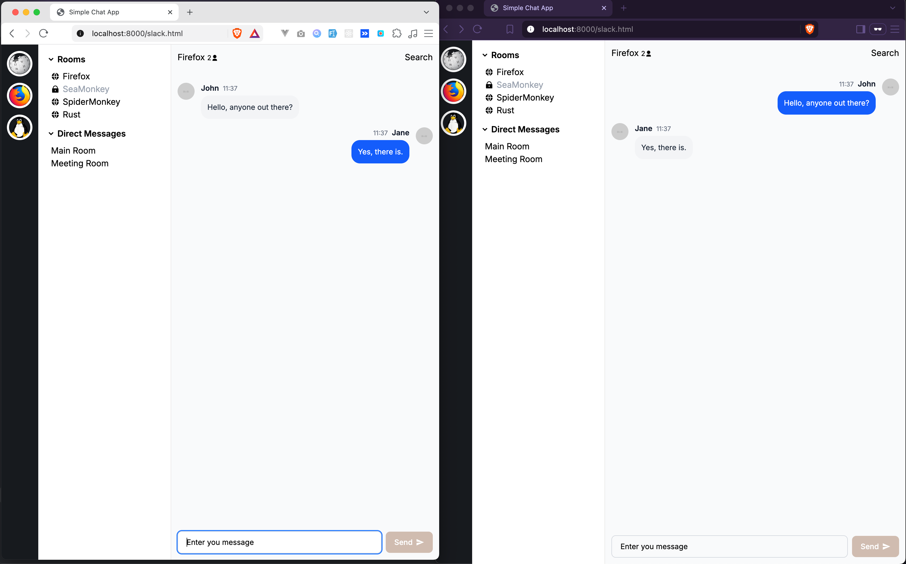

# Simple Chat App (Socket.IO)

A lightweight, real-time web chat application built with **Socket.IO**, JavaScript, and **Tailwind CSS**. This project demonstrates real-time bidirectional event communication, chat room history persistence on join, and modern message UI alignment for both senders and receivers.

---

## 🛠️ Tech Stack

- **Frontend:** HTML5, Vanilla JavaScript, Tailwind CSS
- **Backend / Real-Time:** Node.js, Socket.IO
- **Styling:** Tailwind CSS (utilizing flexbox alignment, customized chat bubbles, and responsive avatars)

---

## ✨ Features

- **Real-Time Messaging:** Instant message broadcasting and syncing across users in active chat rooms using Socket.IO.
- **Room History:** Loads and displays existing room message history upon connection/joining.
- **Dynamic Message Alignment:** 
  * **Receiver Messages:** Automatically aligned to the left with standard neutral chat bubbles.
  * **Sender Messages:** Automatically aligned to the right with distinct primary colored bubbles and reversed layouts.
- **Modular Code Structure:** Uses dynamic client-side HTML builder functions (`buildMessageHtml`) to process incoming message payloads.

---

## 🚀 Getting Started

### Prerequisites
Make sure you have [Node.js](https://nodejs.org/) installed on your machine.

### Installation & Running Locally

1. **Clone the repository:**
   ```bash
   git clone https://github.com/johnrafaellim/SIMPLE_CHAT_APP_SOCKET_IO.git
   cd SIMPLE_CHAT_APP_SOCKET_IO
   ```

2. **Install dependencies:**
   ```bash
   npm install
   ```

3. **Run the application:**
   ```bash
   npm run dev
   ```

---

## 📸 Demo


